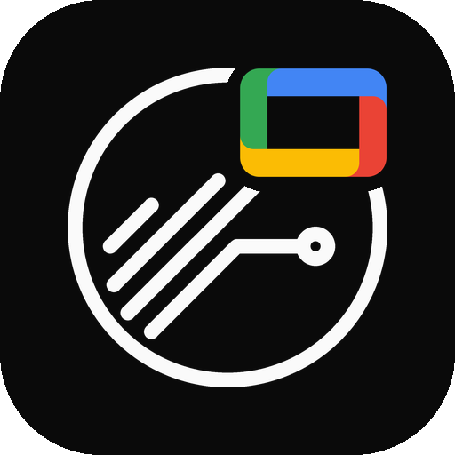

# Raineworks TV

An **unofficial** [Home Assistant](https://www.home-assistant.io/) integration for
Google TV and Android TV, from [Raineworks](https://github.com/raine-works), with a
TV app of its own. One local connection does what used to take the Android TV
Remote, Google Cast and ADB integrations together, and a few things none of them can.

[](https://github.com/hacs/integration)
[](LICENSE)

[](https://github.com/raine-works/ha-googletv/actions/workflows/test.yaml)
[](https://github.com/raine-works/ha-googletv/actions/workflows/validate.yaml)

<a href="https://buymeacoffee.com/raineworks"></a>

> This project is not affiliated with, authorized, or endorsed by Google. Google
> TV and Android TV are trademarks of Google LLC.

## What it does

* **Control the TV**: power (with Wake-on-LAN), volume, every app and HDMI
  input by its name on the TV, a remote, and what's playing in any app
  (Netflix, YouTube TV, Spotify, Plex…) with its artwork. Within a second.
* **Know what it's doing**: an Activity sensor (`off`, `home`, `app`,
  `playing`, `paused`, `input`, `screensaver`) to drive your automations.
* **Notifications on the TV**, over whatever's on, HDMI inputs included:
  text, an image, a clip (a UniFi Protect doorbell's), a **live camera
  over WebRTC in about a second**, a progress bar, **buttons you answer
  with the remote**. **Live notifications** stay up while something's true
  (the front door is open) and update in place.
* **Events from the TV**: a button pressed, a notification dismissed (or
  something on it that didn't load), media played or closed, an app
  installed, as they happen, to trigger automations on.
* **Choose on the TV** which apps and inputs Home Assistant shows, and
  which ones notifications pop up over; or from Home Assistant: they stay
  in step.
* **A media target, in place of Google Cast**: Home Assistant's media
  browser, text-to-speech and cameras play on the TV. Announcements are
  spoken *over* your show, which ducks, instead of stopping it.
* **Dashboards on the TV**: any Home Assistant dashboard, full screen,
  signed in by itself.
* **Simple setup, either way**: install the TV app and choose **Allow** on
  the TV, with no developer mode; or turn on network debugging and Home
  Assistant installs the app itself. Nothing to type, and nothing to look
  after: over ADB, the TV app is kept at the integration's version.

Everything stays on your network, except optional lookups of app icons and
artwork ([Privacy](#privacy-and-security)).

## Setup

[](https://my.home-assistant.io/redirect/hacs_repository/?owner=raine-works&repository=ha-googletv&category=integration)

Install the integration first: in HACS, open **Raineworks TV** with
the button above (or add `https://github.com/raine-works/ha-googletv` as a
custom repository, category **Integration**), download it and restart Home
Assistant. Then connect the TV one of two ways; you can add ADB to a TV
connected through its app at any time.

After that there's nothing to look after. Over ADB, Home Assistant keeps
the TV app at the integration's version: update the integration in HACS and
the TV follows by itself (an app from Google Play is Play's to update).
Through the app alone, a repair says when the TV app is behind.

### With the TV app (no developer mode)

1. **Install the TV app** on the TV and open it. Its screen shows the way:
   a QR code that opens the integration in HACS on your phone, then the
   step below. Google Play is coming; until then, install the Downloader
   app from Google Play and open
   `https://github.com/raine-works/ha-googletv/releases/latest/download/raineworks-tv-bridge.apk`
   in it (no developer options; Android asks once to let Downloader
   install apps).
2. **Add the TV.** It appears in Home Assistant under Settings → Devices &
   services → **Discovered**. Choose **Add**, then **Submit**.
3. **Choose Allow on the TV**, when it asks "Allow Home Assistant to
   connect?". No code to type.
4. **Allow its permissions**, in the TV app's **Permissions** section (its
   Home says "Almost there" while any is off): **Pop-ups over other apps**,
   **Notification access** (what other apps are playing) and **App
   detection** (Android's Usage access: which app is in front). Each opens
   its settings screen.

The TV app's sections: **Home** (connected or not, and anything that needs
a look), **Apps** (which Home Assistant shows, which get pop-ups),
**Pop-ups** (their size and place, a test), **Permissions**, **ADB** (what
it adds, and turning it on) and **About**.

### Over ADB (everything)

1. **Turn on network debugging on the TV.**
   1. Settings → System → About: select **Android TV OS build** seven
      times ("You are now a developer").
   2. Settings → System → Developer options: turn on **USB debugging**, and
      **Network debugging** (or Wireless debugging) where it's a separate
      switch. Sony calls it **ADB debugging**; TCL offers it only while the
      TV is connected to a network.
2. **Add the TV.** It appears under Settings → Devices & services →
   **Discovered**. Choose **Add**, leave **Install the TV app** ticked, and
   **Submit**. On the TV, "Allow USB debugging?" appears: tick **Always
   allow from this computer** and choose **Allow** (the setup waits a
   minute for it).

Home Assistant installs the TV app over ADB, allows its permissions and
pairs with it. A TV over ADB without the app gets a repair, **Install the
TV app**, that does the same at a press. Not discovered? **Add integration
→ Raineworks TV**, with the TV's IP address and port 5555.

**A TV connected through its app, given ADB later**: turn on network
debugging (the TV app's **ADB** section has the steps, with each one's
state), then
in Home Assistant open the TV (Settings → Devices & services → Raineworks
TV), choose **⋮ → Reconfigure**, then **Connect over ADB**. The
app's pairing stays.

### What each way gives

| | TV app alone | Over ADB |
| :--- | :---: | :---: |
| Notifications, live ones, buttons; events | ✓¹ | ✓ |
| Text-to-speech, media, dashboards on the TV | ✓¹ | ✓ |
| Apps (buttons, opening), inputs (switching), volume | ✓¹ | ✓ |
| Play, pause, next, previous | ✓ | ✓ |
| Now playing in other apps (title, artwork, position) | ✓² | ✓ |
| The app in front (Current app sensor, pop-up rules) | ✓³ | ✓ |
| Screen on or off, Activity, diagnostics | ✓ | ✓ |
| Remote keys: D-pad, OK, Back, Home, Settings | | ✓ |
| Turn off; turn on from network standby | | ✓ |
| Which HDMI input is on screen (and its artwork) | | ✓ |
| The TV app kept up to date by Home Assistant | ⁴ | ✓ |

¹ Pop-ups, and opening media, dashboards, apps and inputs over what's on,
need **Pop-ups over other apps** allowed. ² Needs **Notification access**.
³ Needs **Usage access** (App detection). Some TVs hide these settings
screens: ADB allows all three. ⁴ From Google Play, Play updates it;
sideloaded, a repair says when it's behind.

A fixed address for the TV (a DHCP reservation in your router) is optional:
a discovered TV is followed to a new one.

## The TV in Home Assistant

Each TV is a device with these entities.

### Media player

`media_player.<tv>`, device class TV.

| | |
| :--- | :--- |
| State | `off` (asleep), `playing` / `paused` (what the front app reports), else `on` |
| Sources | Every app in the TV's launcher, then its HDMI inputs, by their names on the TV ("Xbox"; "HDMI 2" when unnamed). `source` is the input on screen, else the app in front. A device on HDMI-CEC's own input counts as its port's input |
| Now playing | Title, artist or show and position, from the TV's media sessions, with no Cast needed |
| Artwork | A song's cover (iTunes), a show's poster (TVmaze) or a film's poster (Google Play, else Wikipedia), else the app's icon. On an HDMI input: its icon on its colour (an Xbox's logo on Xbox green), with the input's name as the title |
| Volume | The TV's media volume as a level: set, step, mute |
| Controls | Turn on / off, play, pause, stop, next, previous, select source |
| Media | Browse and play Home Assistant's media, announcements, and apps, inputs and links: see [Media and dashboards](#media-and-dashboards) |
| Attributes | `app_id`, `app_name`, `apps` (package, name and icon), `inputs` (id, port, name, icon, kind, CEC device), `input`, `media_app`, `tv_bridge` (the TV app: `paired`, `installed` or `not_installed`) |

### Activity

`sensor.<tv>_activity`: what the TV is doing, the sensor to trigger
automations on.

| State | When |
| :--- | :--- |
| `off` | The screen is off |
| `screensaver` | The screensaver is on (music playing under it counts as `playing`) |
| `home` | The home screen |
| `app` | An app is open, nothing playing |
| `playing` | Something's playing |
| `paused` | It's paused |
| `input` | An HDMI input is on screen (its name in the `input` attribute) |

### Input

`select.<tv>_input`: the HDMI inputs by their names on the TV, showing the
one on screen. Pick one to switch to it (the TV wakes first).

Each input gets an icon for what's on it, from its name on the TV, else
from the name its device gives itself over HDMI-CEC:

| Kind | Matches | Icon |
| :--- | :--- | :--- |
| `xbox` | Xbox | `mdi:microsoft-xbox` |
| `playstation` | PlayStation, PS4, PS5 | `mdi:sony-playstation` |
| `nintendo_switch` | Nintendo, Switch, Switch 2 | `mdi:nintendo-switch` |
| `nintendo_wii` | Wii, Wii U | `mdi:nintendo-wii` |
| `steam` | Steam, Steam Deck | `mdi:steam` |
| `apple_tv` | Apple TV | `mdi:apple` |
| `laptop` | Laptop, MacBook | `mdi:laptop` |
| `computer` | PC, Computer, Mac | `mdi:desktop-tower-monitor` |
| `streamer` | Chromecast, Fire TV, Roku, Shield | `mdi:television-box` |
| `cable` | Cable, Satellite, TiVo, Box | `mdi:set-top-box` |
| `disc` | Blu-ray, DVD | `mdi:disc-player` |
| `audio` | Soundbar, Receiver, Sonos | `mdi:soundbar` |
| `camera` | Camera, GoPro | `mdi:camera` |
| `console` | Game, Console, Retro | `mdi:controller` |
| `hdmi` | anything else | `mdi:video-input-hdmi` |

### Apps, remote and the rest

* **Current app** (`sensor.<tv>_current_app`): the app in front by name,
  its package in the `package` attribute.
* **Apps**: a button per app on the TV's device ("App · Netflix",
  `button.<tv>_app_netflix`, …), named and pictured from its Google Play
  listing. Press to open it (the
  TV wakes first). Apps installed later get their buttons on their own, and
  an uninstalled app's button goes: at once with the TV app (it says so),
  else within 10 minutes. Apps
  open by their launch screen, so the ones Android TV Remote can no longer
  launch (YouTube TV, Apple TV, HBO Max, Hulu) open here. (Before 2.4 they
  were a device of their own, "<TV> Apps"; it's folded into the TV, and
  the buttons keep their entity ids. The "App ·" and "Remote ·" names
  from 2.4.1 keep each kind together on the device's page.)
* **Choosing apps**: leave an app out of Home Assistant (the Source list,
  the `apps` attribute, its button) with its **Home Assistant** switch in
  the TV app's Apps section, on the integration's **Configure → Apps and
  inputs**, or
  by disabling its button. All three stay in step: disabling a button flips
  the switch on the TV, and the other way round. HDMI inputs have the same
  switch (the TV app's Apps section, or **Configure → Apps and inputs**):
  an input left out goes from the Source list and the Input picker.
* **Remote keys** ("Remote · Home", `button.<tv>_remote_home`, …): Home, Back, Up, Down, Left,
  Right, OK, Play/pause, Volume up, Volume down, Mute and Settings.
* **Remote** (`remote.<tv>`): `remote.send_command` with any key (`HOME`,
  `BACK`, `DPAD_UP` / `DOWN` / `LEFT` / `RIGHT` / `CENTER`, `VOLUME_UP`,
  `MEDIA_PLAY_PAUSE`, `SETTINGS`…) or an Android key code; `num_repeats`
  and `delay_secs` work.
* **Notifications** (`notify.<tv>_notifications`): see below.
* **TV app** (`sensor.<tv>_tv_app`): the TV app's version, its build (the
  commit it was built from) in the `build` attribute.
* **Diagnostics**: Connection (Ethernet or Wi-Fi), Wi-Fi signal, Storage
  used and free, Last restart; IP address and Memory free are there,
  disabled. **Download diagnostics** on the device gives the TV's latest
  reading, its address and identifiers redacted, for bug reports.

The TV is read every second: its screen and what's playing (about 100 ms of
work on the TV), so playing, paused and the screen turning off show within a
second. Every 5 seconds the full read adds the app, volume and inputs (and at
once after a command). The app list and diagnostics every 10 minutes.

## Notifications

The TV app shows Home Assistant's notifications as pop-ups over whatever's
on screen (apps and HDMI inputs alike), in the TV's notification panel, or
both.

The notify entity (`notify.<tv>_notifications`) pops a message up in the
top right. The **`googletv.notify`** action does the rest:

| Field | |
| :--- | :--- |
| `message`, `title` | The text |
| `icon` | The badge: a Home Assistant icon (`mdi:doorbell`), or an image URL or path; the Raineworks TV logo if not set |

Home Assistant paths, and URLs on Home Assistant's own address, are signed
for 15 minutes as Home Assistant's read-only content user before they go to
the TV, so ones that need a sign-in (media, UniFi Protect clips) load. The
camera proxy and camera streams carry their own tokens and are sent as they
are; a live notification is signed afresh each time it's shown again.
| `image` | An image URL, or a Home Assistant path (`/local/doorbell.jpg`, `/media/local/snapshot.jpg`). With a `video`, it shows until the video's first frame: a doorbell's snapshot, then its clip |
| `camera_entity` | A camera on the card. `camera_view`: `live` (the default) opens it over WebRTC when the camera offers it (go2rtc, or a camera with WebRTC of its own), live in about a second, with HLS (2 to 5 seconds) when it doesn't or WebRTC fails to start; `hls`, HLS only; `snapshot`, a still. The camera's snapshot shows until the video starts, unless an `image` is given (a doorbell's ring snapshot): yours wins. An unavailable camera adds nothing (a warning in the log), so the rest of the card still shows |
| `video` | A video or live stream URL (HLS, RTSP, MP4), or a Home Assistant path (a UniFi Protect clip, `/api/unifiprotect/video/…`). A clip is downloaded whole, then loops from the TV; a stream plays as it comes |
| `size` | `compact` (a one-line pill; a camera plays in a small tile on it), `small`, `medium`, `large`; the TV's setting if not given |
| `position` | `top_left`, `top`, `top_right`, `center`, `bottom_left`, `bottom`, `bottom_right`; the TV's setting if not given |
| `duration` | Seconds on screen (8, or 20 with a video); `0` keeps it up until it's dismissed |
| `until_entity`, `until_state` | Keep it up until this entity changes, or reaches `until_state`: a [live notification](#live-notifications) |
| `progress` | A progress bar, 0 to 100 |
| `actions` | Up to 3 buttons, `[{action: UNLOCK, title: Unlock}, …]`: see [Events from the TV](#events-from-the-tv) |
| `color` | The pop-up's border (`#03A9F4`) |
| `mode` | `popup` (over what's on screen), `panel` (the notification panel), `both` |
| `mute` | A video's sound (off by default) |
| `tag` | Send again with the same tag to update it in place; dismiss it by its tag |
| `ignore_rules` | Pop up even where the rules say not to |
| `when_blocked` | Where a pop-up the rules keep off the screen goes: `panel` or `drop` |

The action returns whether it popped up, went to the panel, or why not, and
its `tag`. **`googletv.dismiss_notifications`** takes a notification down by
its tag (or all of them), from the screen and the panel.

### Live notifications

With `until_entity` a notification stays up while something's true, and
goes when it isn't. With `duration: 0` it stays until it's dismissed. Home
Assistant keeps track of them: they survive a restart of Home Assistant
(and come down if the door closed meanwhile), and are shown again if the
TV app restarts.

To show values that change, send the notification again with the same
`tag`. It's updated where it is, with no animation; a camera on it keeps
playing and the panel doesn't alert again. See the
[recipes](#recipes).

### Stacking

Each corner (and the top, bottom and center) holds a stack. Three cards show
at a time: live ones first, then the newest. A "+2 more" pill counts the
rest, which come back as cards go.

### Rules

Pop-ups can stay off the apps and inputs you pick: their **Pop-ups** switch
on the TV app's Apps section, **Configure → Apps and inputs** on the integration, or
**`googletv.set_notification_rules`** (by name: `Netflix`, `Xbox`). An app
can be left out of Home Assistant and still get pop-ups, or the reverse.
Those notifications go to the panel instead, or nowhere. The integration
tells the app which input is on screen, so input rules work.

## Events from the TV

The TV app tells Home Assistant what happens on the TV, as it happens, on a
connection the integration keeps open. Each event fires **`googletv_event`**
on Home Assistant's event bus, with the TV's `device_id`:

| `type` | Data | When |
| :--- | :--- | :--- |
| `notification_action` | `tag`, `action` | A notification's button was pressed |
| `notification_dismissed` | `tag`, `by` (`remote`, `timeout`) | A tagged notification came down on the TV: Back, or its time ran out |
| `notification_failed` | `tag`, `media` (`image`, `icon`, `video`, `webrtc`), `reason` | Something on a notification didn't load on the TV (a camera over WebRTC then falls back to HLS). Also logged as a warning, and on the event entity as **Couldn't load** |
| `player` | `state` (`opened`, `playing`, `paused`, `closed`), `kind`, `title` | Home Assistant's media on the TV |
| `dashboard` | `state` (`opened`, `closed`), `url` | A dashboard on the TV |
| `state` | `change` (`screen`, `volume`) | The screen turned on or off, or the volume changed (the TV is read again at once) |
| `apps` | `change` (`installed`, `uninstalled`, `changed`), `package` | An app was installed or uninstalled (the app list and buttons follow at once) |
| `rules` | `hidden_apps`, `hidden_inputs`, `blocked_apps`, `blocked_inputs`, … | A switch was flipped in the TV app's Apps section (Home Assistant follows) |

Each TV also has a **Notification events** entity
(`event.<tv>_notification_events`): `action` (with `action` and `tag`),
`dismissed` (with `by` and `tag`) or `failed` (with `media`, `reason` and
`tag`).

**Buttons on notifications**: give `googletv.notify` up to three `actions`.
The card takes the remote's focus while it's up, so the remote moves
between its buttons: select one, and its `action` comes back as an event;
press Back to dismiss it. Once it's gone, the remote is the app's again. A
card with buttons stays 30 seconds unless its `duration` says otherwise.
The copy in the notification panel has the same buttons. A live
notification dismissed on the TV isn't shown again.

## Media and dashboards

The TV is a media target, as a Chromecast is, but through the TV app.

| | |
| :--- | :--- |
| **Media browser** | The TV is in the media browser's player list: local media, cameras, radio, anything Home Assistant can browse that's audio, video or an image |
| **`media_player.play_media`** | Audio, video or an image (a media source or URL) plays full screen. A song shows its cover, title, artist and progress (select pauses, left and right skip); a video has the player's controls. Back, the end, or the media player's stop closes it, back to what was on |
| **Announcements** | With `announce: true`, and by default for text-to-speech, audio is spoken *over* what's on, which ducks and comes back, with a pill showing what's said. Announcements queue |
| **Apps, inputs, links** | `media_content_type: app` with a package (`com.netflix.ninja`), `input` with an input id, or `url` with a link the TV opens in its app (a YouTube link in YouTube) |
| **`googletv.show_dashboard`** | A dashboard full screen (`dashboard: dashboard-tv`, `view: cameras`), its sidebar hidden. Back or stop closes it |

While Home Assistant's media plays, the media player shows it like any app's
(title, playing or paused), and the remote's play and pause keys work.

**Dashboards sign in as the TV's own user.** The first time you show one,
the integration makes a local-only Home Assistant user named after the TV,
"Living Room TV (TV)", with a long-lived token the TV app uses. It's
**read-only**: dashboards on the TV show your home but can't switch
anything. To let them control devices, turn on **Dashboards on the TV can
control devices** in the TV's options (Settings → Devices & services →
Raineworks TV → Configure → General). The user is in Settings → People →
Users, where you can remove it; removing the TV removes it too.

**Replacing Google Cast**: everything Home Assistant used Cast for on the
TV works here, so you can remove the Google Cast integration's entries for
your Google TVs (or disable their entities). Casting from your phone's apps
(the Cast button in YouTube or Netflix) is unaffected: that's the TV's own
Chromecast, not Home Assistant. Music Assistant has its own Chromecast
support; it can use the TV through its Home Assistant media player provider
instead.

## Recipes

**Dim the lights while something plays, bring them up when it pauses:**

```yaml
triggers:
  - trigger: state
    entity_id: sensor.living_room_tv_activity
    to: playing
    id: playing
  - trigger: state
    entity_id: sensor.living_room_tv_activity
    from: playing
    to: paused
    id: paused
actions:
  - choose:
      - conditions: "{{ trigger.id == 'playing' }}"
        sequence:
          - action: light.turn_on
            target: { area_id: living_room }
            data: { brightness_pct: 10, transition: 2 }
      - conditions: "{{ trigger.id == 'paused' }}"
        sequence:
          - action: light.turn_on
            target: { area_id: living_room }
            data: { brightness_pct: 60, transition: 2 }
```

**Who's at the door, live, in the corner:**

```yaml
triggers:
  - trigger: state
    entity_id: binary_sensor.doorbell
    to: "on"
actions:
  - action: googletv.notify
    target:
      entity_id: media_player.living_room_tv
    data:
      title: Front door
      message: Someone's at the door
      icon: mdi:doorbell
      camera_entity: camera.front_door
      position: bottom_right
      duration: 30
```

**Unlock the door from the couch:**

```yaml
triggers:
  - trigger: state
    entity_id: binary_sensor.doorbell
    to: "on"
actions:
  - action: googletv.notify
    target:
      entity_id: media_player.living_room_tv
    data:
      tag: doorbell
      title: Front door
      message: Someone's at the door
      camera_entity: camera.front_door
      actions:
        - action: UNLOCK
          title: Unlock
        - action: IGNORE
          title: Ignore
  - wait_for_trigger:
      - trigger: event
        event_type: googletv_event
        event_data:
          type: notification_action
          tag: doorbell
          action: UNLOCK
    timeout: 60
    continue_on_timeout: false
  - action: lock.unlock
    target:
      entity_id: lock.front_door
```

**A pill while the front door is open, gone when it closes:**

```yaml
triggers:
  - trigger: state
    entity_id: binary_sensor.front_door
    to: "on"
actions:
  - action: googletv.notify
    target:
      entity_id: media_player.living_room_tv
    data:
      title: Front door open
      icon: mdi:door-open
      size: compact
      until_entity: binary_sensor.front_door
```

**The washer's progress, until it's done:**

```yaml
triggers:
  - trigger: state
    entity_id: sensor.washer_progress
actions:
  - action: googletv.notify
    target:
      entity_id: media_player.living_room_tv
    data:
      tag: washer
      title: Washer
      message: "{{ states('sensor.washer_time_left') }} left"
      progress: "{{ states('sensor.washer_progress') | int(0) }}"
      icon: mdi:washing-machine
      size: compact
      until_entity: sensor.washer_state
      until_state: idle
```

**Say it over whatever's on** (the show ducks; a pill shows the words):

```yaml
action: tts.speak
target:
  entity_id: tts.home_assistant_cloud
data:
  media_player_entity_id: media_player.living_room_tv
  message: Dinner's ready
```

**The cameras on the TV when someone rings, back to the show after a minute:**

```yaml
triggers:
  - trigger: state
    entity_id: binary_sensor.doorbell
    to: "on"
actions:
  - action: googletv.show_dashboard
    target:
      entity_id: media_player.living_room_tv
    data:
      dashboard: dashboard-tv
      view: cameras
  - delay: 60
  - action: media_player.media_stop
    target:
      entity_id: media_player.living_room_tv
```

## Actions

| Action | |
| :--- | :--- |
| `googletv.notify` | A notification on the TV ([fields](#notifications)) |
| `googletv.dismiss_notifications` | Take a notification down by `tag`, or all of them |
| `googletv.set_notification_rules` | The apps and inputs pop-ups don't show over (`blocked_apps`, `blocked_inputs` by name or id) and `when_blocked` |
| `googletv.show_dashboard` | A dashboard full screen (`dashboard`, `view`) |
| `googletv.install_tv_bridge` | Install or update the TV app now (over ADB it's kept up to date by itself; `development: true` for the latest build from `master`) |

## Privacy and security

* **Local.** The integration talks to the TV over ADB and to the TV app over
  HTTP on your network. Neither goes through Google or the internet.
* **Online lookups**, on by default: app names and icons from Google Play
  (kept in `.storage/googletv.apps`, read again monthly), and artwork for
  what's playing from iTunes, TVmaze, Google Play and Wikipedia. No account
  or key. Turn off **Look up app icons and artwork online** in the TV's
  options (Settings → Devices & services → Raineworks TV →
  Configure → General) to keep everything on your network.
* **ADB.** Home Assistant signs in to every TV with one key, kept in
  `.storage/googletv_adbkey`; each TV trusts it once.
* **Installing or updating the TV app**, Home Assistant checks the
  download against the SHA-256 published with each release before it goes
  on the TV, and never installs over a copy from Google Play.
* **The TV app** pairs with Home Assistant when you choose **Allow** on the
  TV, or over ADB; no code is typed. Every request after that carries its
  token. Ten wrong pairing codes lock pairing for ten minutes. Removing the
  TV from Home Assistant unpairs it.
* **Links sent to the TV** (a notification's image, clip or icon) that
  point at Home Assistant are signed for 15 minutes as Home Assistant's
  read-only content user, so the TV can load them without a sign-in of its
  own. A clip is kept on the TV only while its pop-up is up.
* **Cameras over WebRTC**: the TV app signs in to Home Assistant's
  websocket as the TV's own user (the one dashboards use, read-only unless
  you allow control) and asks for the camera there, as Home Assistant's
  frontend does. Home Assistant gives the app that user's token once; it's
  kept on the TV, and **Forget all Home Assistant pairings** removes it.
* **Dashboards** use the TV's own Home Assistant user
  ([above](#media-and-dashboards)), and stay on Home Assistant: a link to
  another site isn't followed, and only Home Assistant's own pages get the
  sign-in.

## Troubleshooting

**The TV shows as off while it's on standby.** Keep it reachable in standby
so it can be woken and read: on Sony, Settings → Network & Internet →
**Remote start** (some models: Settings → System → Power and energy →
**Network standby**); on TCL, Hisense and others, look for **Network
standby**, **Wake on LAN** or **Quick start**. A TV that drops off its
network anyway is shown **off**, not unavailable, and **Turn on** sends
Wake-on-LAN to its MACs.

**Home Assistant asks to reconnect the TV.** The TV forgot Home Assistant's
key (debugging was turned off and on, or the TV was reset). Open the repair,
be at the TV, and accept the prompt again.

**The TV moved to a new address.** A discovered TV is followed by itself;
otherwise use the integration's **Reconfigure**.

**A live notification is stuck.** Home Assistant takes it down when its
entity changes, or with `googletv.dismiss_notifications`; on the TV, the
app's **Pop-ups → Clear pop-ups** clears them all.

**"Needs ADB".** The TV is connected through its app alone, and only ADB
can do that (the D-pad, turning it off). Add ADB: see [Setup](#setup).

**Notifications don't show.** Check the media player's `tv_bridge`
attribute. `not_installed`: run **Install the TV app**. `installed` but not
`paired`: it pairs by itself within a few minutes. In the TV app's
**Permissions**, **Pop-ups over other apps** must say Allowed (Home
Assistant allows it when it installs the app).

**A doorbell clip or `/media` image doesn't show.** Home Assistant signs
its own links for the TV, but needs to know its address: set it in
Settings → System → Network (the local address the TV can reach).

**A camera doesn't play while you're watching something.** Many TVs
(MediaTek chips: Sony, TCL, Hisense) have one hardware decoder for H.265,
and the show you're watching holds it. Live view over WebRTC (the default,
with go2rtc) copes; for HLS and clips, the TV app falls back to its
software decoder, which is slower to start. A camera channel in H.264
avoids it altogether.

**The TV app is behind the integration.** Over ADB it's updated by itself
when Home Assistant next reads the TV; `googletv.install_tv_bridge` does it
now. Through the app alone, a repair says so: update it where it came from.

**No inputs.** Inputs come from Android's TV input service, used by TCL
(Google TV) and Sony (Android TV) among others; a TV whose maker doesn't use
it shows none.

**Another ADB integration.** Only one ADB client can hold a TV comfortably:
remove the TV from Home Assistant's **Android Debug Bridge** integration (or
anything else using ADB on it) first.

Requires Home Assistant 2025.2 or newer.

## Development

```bash
pip install -r requirements-test.txt     # parser tests and ruff
pytest -q
pip install -r requirements-test-ha.txt  # with Home Assistant: config flow and setup
pytest -q
```

The parsers (`custom_components/googletv/parsers.py`) are tested on output
captured from real TVs. The TV app is in `android/` (built by CI, attached
to each release); its API is documented in `protocol/README.md`. Sideloaded
builds are signed with a development key kept in the repo.

## ☕ Support

If you find this project helpful, consider buying me a coffee to support
continued maintenance and development:

<a href="https://buymeacoffee.com/raineworks"></a>

## License

MIT
