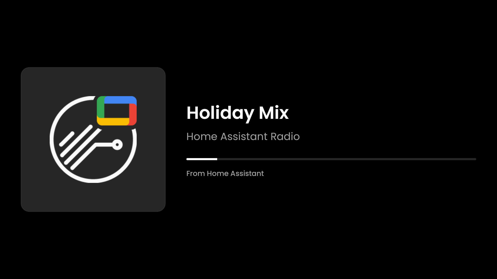
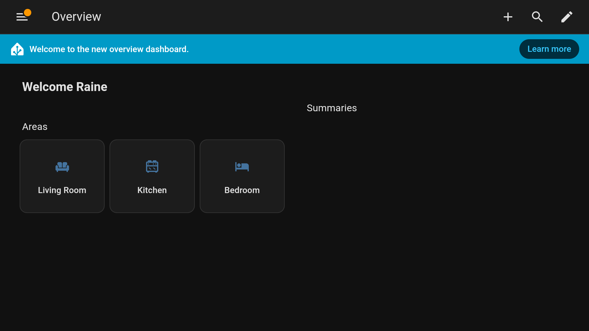

# Media and dashboards

The TV is a media target, as a Chromecast is, but through the TV app.

| | |
| :--- | :--- |
| **Media browser** | The TV is in the media browser's player list: local media, cameras, radio, anything Home Assistant can browse that's audio, video or an image |
| **`media_player.play_media`** | Audio, video or an image (a media source or URL) plays full screen. A song shows its cover, title, artist and progress (select pauses, left and right skip); a video has the player's controls. Back, the end, or the media player's stop closes it, back to what was on |
| **Announcements** | With `announce: true`, and by default for text-to-speech, audio is spoken *over* what's on, which ducks and comes back, with a pill showing what's said. Announcements queue |
| **Apps, inputs, links** | `media_content_type: app` with a package (`com.netflix.ninja`), `input` with an input id, or `url` with a link the TV opens in its app (a YouTube link in YouTube) |
| **`googletv.show_dashboard`** | A dashboard full screen (`dashboard: dashboard-tv`, `view: cameras`), its sidebar hidden. Back or stop closes it |

While Home Assistant's media plays, the media player shows it like any app's
(title, playing or paused), and the remote's play and pause keys work.

**Dashboards sign in as the TV's own user.** The first time you show one,
the integration makes a local-only Home Assistant user named after the TV,
"Living Room TV (TV)", with a long-lived token the TV app uses. It's
**read-only**: dashboards on the TV show your home but can't switch
anything. To let them control devices, turn on **Dashboards on the TV can
control devices** in the TV's options (Settings → Devices & services →
Raineworks TV → Configure → General). The user is in Settings → People →
Users, where you can remove it; removing the TV removes it too.

**Replacing Google Cast**: everything Home Assistant used Cast for on the
TV works here, so you can remove the Google Cast integration's entries for
your Google TVs (or disable their entities). Casting from your phone's apps
(the Cast button in YouTube or Netflix) is unaffected: that's the TV's own
Chromecast, not Home Assistant. Music Assistant has its own Chromecast
support; it can use the TV through its Home Assistant media player provider
instead.
