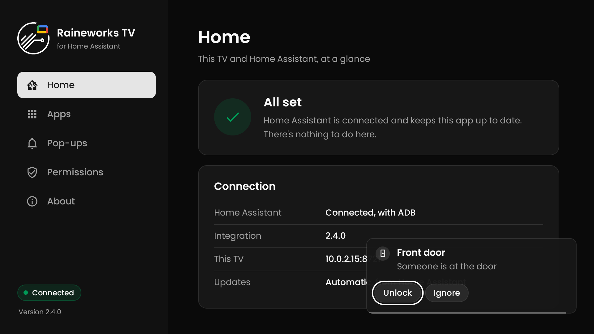

# Notifications

The TV app shows Home Assistant's notifications as pop-ups over whatever's
on screen (apps and HDMI inputs alike), in the TV's notification panel, or
both.

The notify entity (`notify.<tv>_notifications`) pops a message up in the
top right. The **`googletv.notify`** action does the rest:

| Field | |
| :--- | :--- |
| `message`, `title` | The text |
| `icon` | The badge: a Home Assistant icon (`mdi:doorbell`), or an image URL or path; the Raineworks TV logo if not set |

| `image` | An image URL, or a Home Assistant path (`/local/doorbell.jpg`, `/media/local/snapshot.jpg`). With a `video`, it shows until the video's first frame: a doorbell's snapshot, then its clip |
| `camera_entity` | A camera on the card. `camera_view`: `live` (the default) opens it over WebRTC when the camera offers it (go2rtc, or a camera with WebRTC of its own) and sends H.264 (not H.265), live in about a second, with HLS (2 to 5 seconds) when it doesn't or WebRTC fails to start; `hls`, HLS only; `snapshot`, a still. The camera's snapshot shows until the video starts, unless an `image` is given (a doorbell's ring snapshot): yours wins. An unavailable camera adds nothing (a warning in the log), so the rest of the card still shows |
| `video` | A video or live stream URL (HLS, RTSP, MP4), or a Home Assistant path (a UniFi Protect clip, `/api/unifiprotect/video/…`). A clip is downloaded whole, then loops from the TV; a stream plays as it comes |
| `size` | `compact` (a one-line pill; a camera plays in a small tile on it), `small` (a card 232 dp wide, its text a little smaller), `medium` (340 dp), `large` (440 dp); the TV's setting if not given |
| `position` | `top_left`, `top`, `top_right`, `center`, `bottom_left`, `bottom`, `bottom_right`; the TV's setting if not given |
| `duration` | Seconds on screen (8, or 20 with a video); `0` keeps it up until it's dismissed |
| `until_entity`, `until_state` | Keep it up until this entity changes, or reaches `until_state`: a [live notification](#live-notifications) |
| `progress` | A progress bar, 0 to 100 |
| `actions` | Up to 3 buttons, `[{action: UNLOCK, title: Unlock}, …]`: see [Events from the TV](events.md) |
| `color` | The pop-up's border (`#03A9F4`) |
| `mode` | `popup` (over what's on screen), `panel` (the notification panel), `both` |
| `mute` | A video's sound (off by default). A camera over WebRTC receives sound only when it's on: muted, it asks for video alone |
| `tag` | Send again with the same tag to update it in place; dismiss it by its tag |
| `ignore_rules` | Pop up even where the rules say not to |
| `when_blocked` | Where a pop-up the rules keep off the screen goes: `panel` or `drop` |

Home Assistant paths, and URLs on Home Assistant's own address, are signed
for 15 minutes as Home Assistant's read-only content user before they go to
the TV, so ones that need a sign-in (media, UniFi Protect clips) load. The
camera proxy and camera streams carry their own tokens and are sent as they
are; a live notification is signed afresh each time it's shown again.

The action returns whether it popped up, went to the panel, or why not, and
its `tag`. **`googletv.dismiss_notifications`** takes a notification down by
its tag (or all of them), from the screen and the panel.

## Live notifications

With `until_entity` a notification stays up while something's true, and
goes when it isn't. With `duration: 0` it stays until it's dismissed. Home
Assistant keeps track of them: they survive a restart of Home Assistant
(and come down if the door closed meanwhile), and are shown again if the
TV app restarts.

To show values that change, send the notification again with the same
`tag`. It's updated where it is, with no animation; a camera on it keeps
playing and the panel doesn't alert again. See the
[recipes](recipes.md).

## Stacking

Each corner (and the top, bottom and center) holds a stack. Three cards show
at a time: live ones first, then the newest. A "+2 more" pill counts the
rest, which come back as cards go.

## Rules

Pop-ups can stay off the apps and inputs you pick: their **Pop-ups** switch
on the TV app's Apps section, **Configure → Apps and inputs** on the integration, or
**`googletv.set_notification_rules`** (by name: `Netflix`, `Xbox`). An app
can be left out of Home Assistant and still get pop-ups, or the reverse.
Those notifications go to the panel instead, or nowhere. The integration
tells the app which input is on screen, so input rules work.
