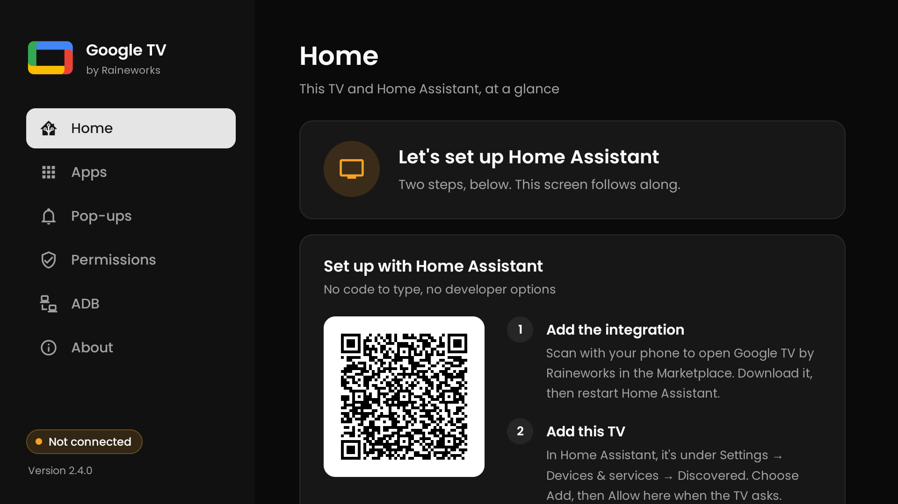
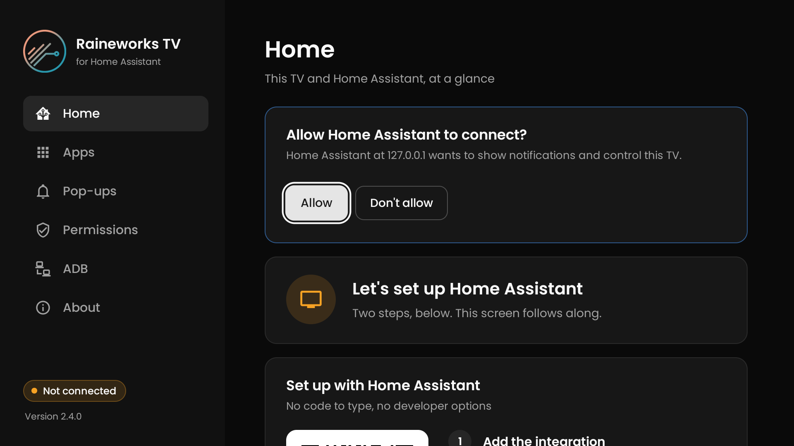
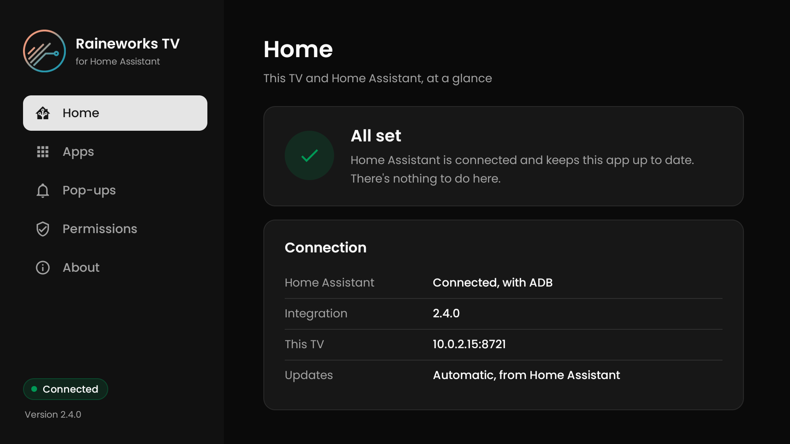

# Setup

Requires Home Assistant 2025.2 or newer.

## Install the integration

1. Open **Google TV by Raineworks** in the Home Assistant Marketplace with the button
   above, or go to Settings → Marketplace. If it isn't listed, add
   `https://github.com/raine-works/ha-googletv` as a custom repository,
   type **Integration**.
2. Download it.
3. Restart Home Assistant.

Then connect the TV one of two ways; you can add ADB to a TV connected
through its app at any time.

After that there's nothing to look after. Over ADB, Home Assistant keeps
the TV app at the integration's version: update the integration in the Home Assistant Marketplace and
the TV follows by itself.
Through the app alone, a repair says when the TV app is behind.

## With the TV app (no developer mode)

1. **Install the TV app** on the TV and open it. Its screen shows the way:
   a QR code that opens the integration in the Home Assistant Marketplace on your phone, then the
   step below. Without ADB, install it with the Downloader app (from the
   TV's app store): open
   `https://github.com/raine-works/ha-googletv/releases/latest/download/raineworks-tv-bridge.apk`
   in it (no developer options; Android asks once to let Downloader
   install apps). With ADB, Home Assistant installs it for you.
2. **Add the TV.** Scan the TV app's second QR code (**Add this TV**), or
   choose **Add integration → Google TV by Raineworks** in Home Assistant: it lists the
   TVs with the app on its network that aren't added yet. Pick this one and
   **Submit**. (It may also show under Settings → Devices & services →
   **Discovered**.)
3. **Choose Allow on the TV**, when it asks "Allow Home Assistant to
   connect?". No code to type.
4. **Allow its permissions**, in the TV app's **Permissions** section (its
   Home says "Almost there" while any is off): **Pop-ups over other apps**,
   **Notification access** (what other apps are playing) and **App
   detection** (Android's Usage access: which app is in front). Each opens
   its settings screen.

The TV app's sections: **Home** (connected or not, and anything that needs
a look), **Apps** (which Home Assistant shows, which get pop-ups),
**Pop-ups** (their size and place, a test), **Permissions**, **ADB** (what
it adds, and turning it on) and **About**.

## Over ADB (everything)

1. **Turn on network debugging on the TV.**
   1. Settings → System → About: select **Android TV OS build** seven
      times ("You are now a developer").
   2. Settings → System → Developer options: turn on **USB debugging**, and
      **Network debugging** (or Wireless debugging) where it's a separate
      switch. Sony calls it **ADB debugging**; TCL offers it only while the
      TV is connected to a network.
2. **Add the TV.** It appears under Settings → Devices & services →
   **Discovered**. Choose **Add**, leave **Install the TV app** ticked, and
   **Submit**. On the TV, "Allow USB debugging?" appears: tick **Always
   allow from this computer** and choose **Allow** (the setup waits a
   minute for it).

Home Assistant installs the TV app over ADB, allows its permissions and
pairs with it. A TV over ADB without the app gets a repair, **Install the
TV app**, that does the same at a press. Not discovered? **Add integration
→ Google TV by Raineworks**, with the TV's IP address and port 5555.

**A TV connected through its app, given ADB later**: turn on network
debugging (the TV app's **ADB** section has the steps, with each one's
state), then
in Home Assistant open the TV (Settings → Devices & services → Raineworks
TV), choose **⋮ → Reconfigure**, then **Connect over ADB**. The
app's pairing stays.

## What each way gives

| | TV app alone | Over ADB |
| :--- | :---: | :---: |
| Notifications, live ones, buttons; events | ✓¹ | ✓ |
| Text-to-speech, media, dashboards on the TV | ✓¹ | ✓ |
| Apps (buttons, opening), inputs (switching), volume | ✓¹ | ✓ |
| Play, pause, next, previous | ✓ | ✓ |
| Now playing in other apps (title, artwork, position) | ✓² | ✓ |
| The app in front (Current app sensor, pop-up rules) | ✓³ | ✓ |
| Screen on or off, Activity, diagnostics | ✓ | ✓ |
| Remote keys: D-pad, OK, Back, Home, Settings | | ✓ |
| Turn off; turn on from network standby | | ✓ |
| Which HDMI input is on screen (and its artwork) | | ✓ |
| The TV app kept up to date by Home Assistant | ⁴ | ✓ |

¹ Pop-ups, and opening media, dashboards, apps and inputs over what's on,
need **Pop-ups over other apps** allowed. ² Needs **Notification access**.
³ Needs **Usage access** (App detection). Some TVs hide these settings
screens: ADB allows all three. ⁴ A repair says when it's behind.

A fixed address for the TV (a DHCP reservation in your router) is optional:
a discovered TV is followed to a new one.
